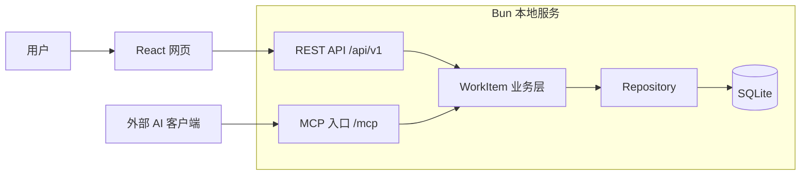

# DedsiWork 总体方案

日期：2026 年 10 月 14 日

DedsiWork 定位为本地优先的工作项管理工具：用户通过网页管理 WorkItem，外部 AI 应用通过 MCP 操作同一批工作项，所有业务数据保存在本机。前端采用 React + TypeScript，由 Bun 提供开发工具和本地服务运行环境。

建议第一版采用单仓库、单个 Bun 常驻服务、单个 SQLite 数据库。网页接口与 MCP 工具共用业务层，先完成创建、查询、修改、删除、恢复和状态跟踪，再考虑自动执行任务。

本方案以本次明确的需求为基准。SQLite、字段设计、接口及阶段划分是本次提出的设计建议；原对话的助手正文尚未完整取得，因此本文不作为原对话的逐项复述。

## 产品目标与范围

核心使用场景是：在网页中新建一个工作项，在 AI 客户端中查询并补充该工作项，然后回到网页查看最新状态与操作记录。关闭浏览器后，本地服务仍可以向 MCP 客户端提供能力；退出本地服务后，数据保留在磁盘，网页和 MCP 暂时不可用。

第一版按单用户、本机使用设计。WorkItem 表示待办事项、需求或缺陷，暂不承担执行进程、模型会话和任务调度的职责。

| 范围 | 第一版设计 |
| --- | --- |
| 工作项管理 | 创建、列表、详情、编辑、状态变更、软删除和恢复 |
| 查询 | 关键词、状态、类型、优先级筛选及分页 |
| 协作记录 | 网页与 MCP 修改统一写入活动记录 |
| AI 接入 | 提供操作 WorkItem 的 MCP Server |
| 数据持久化 | 本地 SQLite 文件、数据库迁移和备份恢复流程 |
| 界面 | 工作项列表、详情编辑、回收站、服务信息 |
| 后续扩展 | 看板、项目、标签、评论、自动执行、远程访问 |

本期不引入多租户、云同步或桌面外壳。用户不需要为了管理本地工作项部署独立数据库服务。

## 技术选型

| 层次 | 建议技术 | 用途 |
| --- | --- | --- |
| 网页 | React + TypeScript | 列表、详情和编辑交互 |
| 开发与运行 | Bun | 依赖管理、TS/TSX 构建、开发服务及后端运行 |
| HTTP 服务 | Bun.serve | 提供网页资源、REST API 和 MCP HTTP 入口 |
| 请求校验 | Zod | 校验 API 与 MCP 的输入，并导出共享类型 |
| 本地存储 | SQLite + bun:sqlite | 持久化、事务、查询与迁移 |
| MCP | 官方 TypeScript SDK | 工具注册、协议协商与传输适配 |
| 验证 | Bun 测试与独立 TypeScript 类型检查 | 业务、存储与接口验证 |

React 页面最终在浏览器中运行；Bun 负责构建前端并运行本地服务。浏览器通过 HTTP 访问数据，不直接打开 SQLite 文件。

Bun 的全栈开发服务支持 HTML 入口、前端资源构建和 React 开发流程，适合作为第一版工具链。生产运行时关闭开发模式，只提供构建后的资源。具体脚本在初始化项目时落实。[Bun 全栈开发文档](https://bun.sh/docs/bundler/fullstack)

Bun 内置 `bun:sqlite` 驱动，支持预编译语句和事务；建议先直接封装 Repository，保持数据库层简单。[Bun SQLite 文档](https://bun.sh/docs/runtime/sqlite)

MCP SDK 采用官方当前稳定版本并锁定依赖。官方文档目前将 v2 列为稳定分支，服务端包为 `@modelcontextprotocol/server`；开发时统一使用同一主版本文档，避免混用旧版示例。[MCP TypeScript SDK](https://ts.sdk.modelcontextprotocol.io/v2/)

## 总体架构



建议默认地址为 `http://127.0.0.1:3210`，端口可配置。一个服务进程提供三个入口：`/` 提供网页，`/api/v1` 提供业务接口，`/mcp` 提供 MCP 协议接口。端口只是项目默认值，启动时必须检查占用。

业务层负责字段校验、状态规则、版本冲突和活动记录。REST 与 MCP 只负责身份识别、协议解析及结果映射，不能各自实现一份修改工作项的规则。

数据库由本地服务统一访问。网页与 MCP 客户端均不直接修改数据库文件，以便确保校验、版本检查和记录写入始终一致。

## 模块划分

| 模块 | 职责 | 主要边界 |
| --- | --- | --- |
| Web | 展示、表单、筛选、请求状态 | 不导入服务端数据库代码 |
| Contracts | 输入输出结构、枚举、共享校验 | 不依赖浏览器或 Bun 专属 API |
| WorkItemService | 业务规则、事务协调、版本检查 | 不依赖 HTTP 或 MCP 对象 |
| Repository | SQL 查询、持久化、数据库映射 | 不处理页面和协议错误格式 |
| REST Adapter | HTTP 路由、认证、错误码 | 调用业务层 |
| MCP Adapter | 工具定义、参数解析、结果映射 | 调用同一业务层 |
| Infrastructure | 配置、数据库迁移、日志与关闭流程 | 向业务层提供基础能力 |

第一版不需要拆成微服务。按模块组织代码已经足以支持后续增加 CLI、自动执行器或其他入口。

## WorkItem 数据模型

建议先提供以下字段，保持创建表单足够简单：用户只需填写标题，其余字段有默认值。

| 字段 | 类型 | 规则 |
| --- | --- | --- |
| id | string | 服务端生成 UUID，永久标识 |
| title | string | 必填，去除首尾空白后 1 至 200 字符 |
| description | string | 默认空字符串，支持 Markdown 文本 |
| type | enum | `task`、`bug`、`feature`，默认 `task` |
| status | enum | `todo`、`in_progress`、`blocked`、`done`、`cancelled` |
| priority | enum | `low`、`normal`、`high`、`urgent`，默认 `normal` |
| dueAt | string 或 null | 可选截止时间，接口使用带时区的 ISO 8601 |
| version | integer | 初始为 1，每次修改递增 |
| createdAt | string | 服务端生成，UTC |
| updatedAt | string | 服务端生成，UTC |
| deletedAt | string 或 null | 软删除时间，正常记录为 null |

页面按用户本地时区显示时间。数据库字段使用 `snake_case`，接口使用 `camelCase`，转换统一放在 Repository 边界。

状态建议采用以下规则：新建默认为 `todo`；未结束的工作项可以转入 `in_progress`、`blocked`、`done` 或 `cancelled`；`done` 和 `cancelled` 通过“重新打开”回到 `todo`。状态变更均留下活动记录，删除状态与业务状态分开保存。

第一版数据库包含四类表：

| 表 | 内容 |
| --- | --- |
| work_items | 工作项主体 |
| work_item_events | 创建、修改、状态变化、删除及恢复记录 |
| schema_migrations | 已执行的迁移版本 |
| idempotency_records | 创建请求的幂等键、输入摘要及返回结果 |

`work_item_events` 保存事件 ID、工作项 ID、动作、变更字段、来源、服务端时间和请求 ID。来源区分 `web` 与 `mcp`，客户端身份由认证上下文确定，不能仅相信调用者提交的名称。

工作项写入、版本递增、活动记录和幂等记录应在同一事务中完成。首批索引围绕未删除记录的更新时间排序，以及状态筛选设计；关键词搜索先支持标题与描述的简单匹配，数据量增长后再引入全文索引。

## 网页交互

首页采用工作项列表，提供关键词搜索、状态筛选、类型筛选、优先级筛选和“新建工作项”。行内展示标题、状态、优先级与更新时间，点击后进入详情。

详情页展示描述、状态、优先级、截止时间和活动记录。第一版使用明确的保存按钮，保存成功后更新当前版本；存在未保存内容时，不因后台刷新而覆盖输入。

回收站支持查看和恢复软删除的工作项。首版不提供永久删除入口，避免把数据清理机制引入基本 CRUD 流程。

服务信息页面展示服务地址、运行版本、数据库路径和 MCP 连接说明。连接凭据应通过受控配置管理，不在普通日志或页面 URL 中长期暴露。

MCP 修改后，网页可以通过重新聚焦时刷新和约 5 秒的可见页面轮询获取变化。编辑表单收到更新时提示“已有新版本”，由用户比较后重新保存。若后续需要即时同步，再增加独立的业务 SSE 事件入口。

## REST API 设计

以下路径是拟定的应用接口，与 MCP 协议接口分别维护。

| 方法 | 路径 | 行为 |
| --- | --- | --- |
| GET | `/healthz` | 返回服务是否就绪，不返回敏感配置 |
| GET | `/api/v1/work-items` | 筛选、分页查询 |
| POST | `/api/v1/work-items` | 创建工作项 |
| GET | `/api/v1/work-items/:id` | 查询详情 |
| PATCH | `/api/v1/work-items/:id` | 部分更新，提交 expectedVersion |
| DELETE | `/api/v1/work-items/:id` | 软删除，通过 If-Match 提交版本 |
| POST | `/api/v1/work-items/:id/restore` | 恢复，提交 expectedVersion |
| GET | `/api/v1/work-items/:id/events` | 分页读取活动记录 |

列表参数包括 `q`、`status`、`type`、`priority`、`page`、`pageSize` 和 `deleted`。默认每页 20 条，最大 100 条，按 `updatedAt DESC, id DESC` 排序。第一版分页面向小规模本地数据；并发变更时允许刷新重新获取列表。

统一返回结构使用 `{ data, meta }`，错误使用 `{ error: { code, message, details }, requestId }`。字段错误返回 400，未认证返回 401，权限不足返回 403，不存在返回 404，版本冲突返回 409，未知错误返回 500。HTTP 层和 MCP 层共享稳定的业务错误码。

例如，网页读取版本 3 后，MCP 已将记录改为版本 4。网页携带 `expectedVersion: 3` 保存时必须失败并返回冲突，不能覆盖 MCP 的修改。数据库通过带版本条件的更新并检查受影响行数实现这一约束。

创建接口支持 `Idempotency-Key`；MCP 创建工具支持等价的 `requestKey`。相同调用身份、相同键和相同参数返回原结果；同一键但不同参数返回冲突，避免超时重试产生重复工作项。

## MCP Server 设计

DedsiWork 在第一版中承担 MCP Server 的角色，由外部 AI 应用作为客户端连接。AI 可以查询、创建和更新工作项；工作项被创建后不会自动触发模型或命令执行。

推荐主入口采用 Streamable HTTP，复用常驻服务的 `/mcp`。如果目标客户端只支持 stdio，再增加一个轻量 stdio 适配进程，将业务调用转发到本地 API；该适配进程不打开数据库，也不另外启动一套业务服务。

MCP 标准包含 stdio 与 Streamable HTTP 两种传输方式。stdio 模式的标准输出只用于协议消息，日志应写入标准错误。[MCP 传输规范](https://modelcontextprotocol.io/specification/2025-11-25/basic/transports)

建议提供以下工具：

| 工具 | 输入重点 | 输出 |
| --- | --- | --- |
| `work_item_list` | 筛选条件、分页 | 精简工作项列表及分页信息 |
| `work_item_get` | id | 完整工作项 |
| `work_item_create` | title、可选字段、requestKey | 新工作项及版本 |
| `work_item_update` | id、expectedVersion、待修改字段 | 更新后的工作项 |
| `work_item_delete` | id、expectedVersion | 软删除结果 |
| `work_item_restore` | id、expectedVersion | 恢复后的工作项 |
| `work_item_events` | id、分页 | 活动记录 |

每个工具定义输入 schema、清晰的用途说明和结构化输出。查询列表默认不返回完整长描述，AI 需要时调用详情工具，减少上下文占用。业务失败应转换为客户端可理解的工具错误，版本冲突时返回当前版本供重新读取。

工具的只读、写入和删除提示有助于客户端展示行为，但真正的权限限制由服务端执行。建议连接凭据区分只读和读写权限，写工具显式校验权限。

MCP 接口不能当成普通 REST 路由简单转发 JSON。初始化、协议版本协商、工具发现、调用格式和连接生命周期由官方 SDK 处理。资源和提示模板可以在后续增加，第一版以工具调用完成核心场景。

这里的本地地址仅适用于能够访问本机网络的客户端。运行在远端云环境的客户端无法直接连接用户电脑的 `127.0.0.1`；远程接入需要另外设计网络入口及认证部署。

## 本地运行与数据管理

日常运行流程为：启动服务，读取配置，打开数据库，执行待处理迁移，通过就绪检查后提供网页、API 和 MCP。启动日志显示访问地址、端口和数据目录；浏览器只作为操作界面。

开发数据可放在仓库的 `data` 目录并加入版本控制忽略规则。正式使用建议默认写入 `%LOCALAPPDATA%\DedsiWork`，同时允许通过 `DEDSIWORK_DATA_DIR` 指定位置。最终必须解析为固定绝对路径，避免从不同工作目录启动时误创建多个数据库。

建议配置项：

| 配置 | 默认建议 |
| --- | --- |
| `DEDSIWORK_HOST` | `127.0.0.1` |
| `DEDSIWORK_PORT` | `3210` |
| `DEDSIWORK_DATA_DIR` | 用户本地应用数据目录 |
| `DEDSIWORK_LOG_LEVEL` | `info` |

SQLite 启用外键检查、WAL 和合理的忙等待超时。事务保持短小，网络调用放在事务之外。`bun:sqlite` 使用同步 API，因此较大的导入和备份操作后续应单独安排，避免阻塞正常请求。[Bun SQLite 文档](https://bun.sh/docs/runtime/sqlite)

第一版备份采用停止服务、正常关闭数据库后复制完整数据目录的方式，恢复时同样先停止服务，并保留恢复前副本。在线备份留到后续通过 SQLite 的一致性备份机制实现；运行中只复制主数据库文件不能作为可靠备份方案。

服务退出时停止接受新请求，完成或中止剩余请求并关闭数据库。重复启动遇到端口占用应明确报错，不静默改用其他端口，以免 MCP 客户端连到错误实例。数据库迁移在事务中执行，失败则停止启动并保留诊断信息。

## 本地访问保护

默认仅监听回环地址。对 HTTP 请求验证 Host，并按明确的允许列表校验 Origin；网页与 API 同源，拒绝来自其他网站的跨域写入。MCP HTTP 使用认证凭据，无 Origin 的合法原生客户端仍需通过认证。[MCP 本地 HTTP 传输要求](https://modelcontextprotocol.io/specification/2025-11-25/basic/transports)

网页端可采用本地配对后建立 HttpOnly、SameSite 严格模式会话的方式，写请求同时校验 CSRF 信息；MCP 使用独立 bearer 凭据。配对与凭据签发需要本地操作者参与，不能把令牌放进公开静态资源。具体认证流程在实现阶段单独形成接口约定。

数据库使用参数化 SQL；Markdown 展示不直接执行原始 HTML；接口限制描述长度和请求体大小。日志记录动作、耗时、请求 ID 和结果，不默认输出凭据或完整工作项正文。

## 建议目录

```text
DedsiWork/
  docs/
    总体方案.md
  src/
    web/
      components/
      pages/
      api/
      index.html
      main.tsx
    shared/
      work-item.schema.ts
      errors.ts
    server/
      main.ts
      config.ts
      api/
      mcp/
      services/
      repositories/
      db/
        migrations/
      infrastructure/
  tests/
    unit/
    integration/
  data/
  package.json
  tsconfig.json
  bun.lock
```

前后端暂时共用一个 package.json。TypeScript 配置区分浏览器和服务端的检查边界，防止把 Bun 专属代码打包进网页。依赖版本及锁文件提交到仓库；数据库文件、日志、凭据和本地配置不提交。

拟定开发命令包括 `bun install`、`bun run dev`、`bun run typecheck`、`bun test`、`bun run build` 和 `bun run start`。这些是后续应实现的脚本约定，当前交付内容为设计文档。

## 实施顺序与验收

| 阶段 | 交付内容 | 验收标准 |
| --- | --- | --- |
| 一 基础验证 | Bun 服务、React 页面、SQLite 连接、最小 MCP 工具 | 本机启动成功；真实目标 MCP 客户端完成连接、工具发现和一次调用 |
| 二 业务闭环 | 数据迁移、WorkItemService、REST、列表与详情 | 网页完成 CRUD、删除恢复；重启服务后数据存在 |
| 三 MCP 集成 | 全部核心工具、活动记录、版本和幂等控制 | MCP 创建的工作项可在网页查看；网页修改可由 MCP 查询；过期版本被拒绝 |
| 四 可用性完善 | 筛选、分页、回收站、认证、日志、备份恢复 | 非法访问被拒绝；备份可恢复；错误信息可定位问题 |

基础验证应尽早使用用户实际要接入的 MCP 客户端，确认传输、认证和协议兼容性。当前本机 Bun 已检测为 1.4.2；初始化时记录已验证版本并锁定依赖，不能仅凭文档支持就跳过集成验证。

重点测试业务边界：状态变化、空标题、非法枚举、找不到记录、已删除记录访问、恢复、版本冲突、重复创建重试，以及活动记录与主体修改是否原子提交。使用临时 SQLite 文件验证迁移、重启持久化和备份恢复，不对用户正式数据库运行测试。

第一版整体完成标准：启动一个本地服务后，网页与 MCP 能可靠操作同一批工作项；发生并发修改时不丢数据；退出并重启后数据仍然可用。

## 后续扩展方向

如果需要“在网页点击执行，由 AI 自动完成工作”，建议增加独立的 `Run` 实体，保存所关联的 WorkItem、执行器、排队或运行状态、开始结束时间、日志和产物。一个 WorkItem 可以对应多次 Run，工作项状态与执行进程状态分别管理。

只有在引入自动执行时，才增加执行队列、超时、取消、重试、进程隔离，以及调用外部模型或 MCP Server 的客户端能力。这样当前的工作项 CRUD 与 MCP Server 可以先独立交付，也为后续执行功能保留清晰边界。

产品层面建议优先扩展项目归属、标签、评论和看板；当确有多设备或多人协作需求时，再调整认证、网络入口与数据库部署方式。
